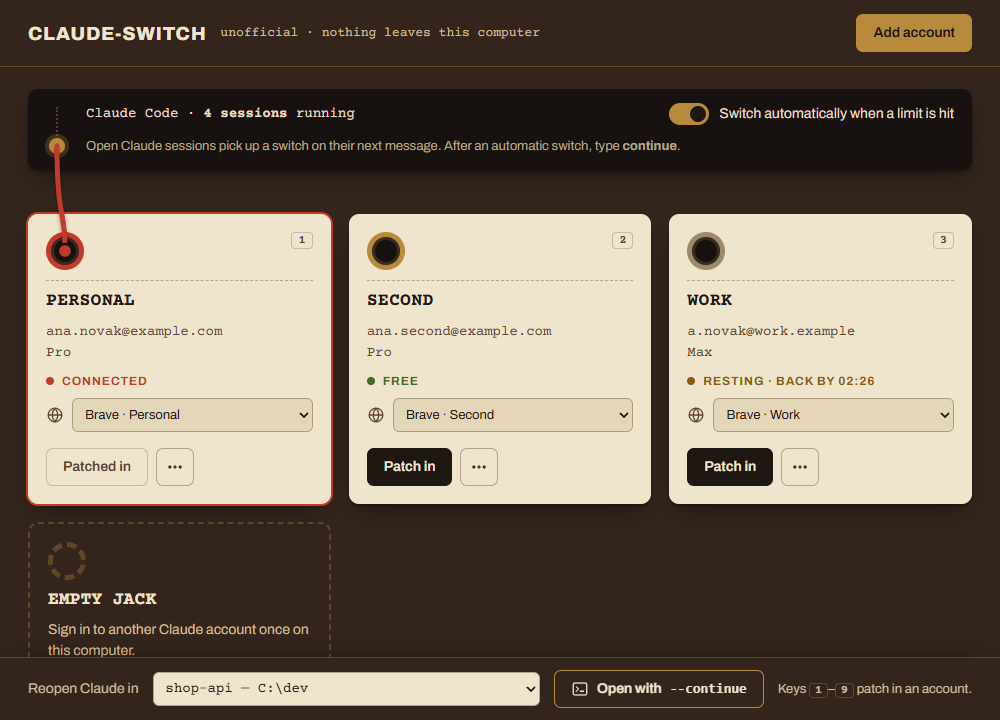

# claude-switch

Switch [Claude Code](https://claude.com/claude-code) between several Claude accounts in one click, and keep working in the same conversation when one account hits its usage limit.

<picture>
  <source media="(prefers-color-scheme: light)" srcset="docs/screenshot-light.png">
  
</picture>

> Unofficial community tool. Not affiliated with or endorsed by Anthropic. Nothing leaves your computer.

- **Any number of accounts.** Sign in to each one once; switching swaps Claude Code's stored login instead of logging in again.
- **See each account's limits.** Every account shows how much of its 5-hour session and weekly limit is used, and when each resets (the same numbers as Claude Code's `/usage`).
- **Auto-switch on limit.** When a reply fails because the account hit its usage limit, the next account that isn't limited is switched in. Type `continue` in the same Claude window and carry on. Open sessions pick up a switch on their next message.
- **Browser profiles for Claude in Chrome.** The extension only connects to Claude Code when it is signed in to the same account. Pair each account with a profile in Chrome, Edge, Brave, Vivaldi or Chromium, and switching opens the right one.
- **App window, tray icon (Windows) and a CLI**, all sharing the same accounts.

Works on **Windows** and **Linux**. macOS is not supported (Claude Code keeps its login in the Keychain there).

## Install

Download or clone this repository, then:

- **Windows:** double-click `install.cmd`. It installs Node.js and Claude Code if they're missing, adds a Start menu entry, a tray icon that starts at sign-in, and the `claude-switch` command.
- **Linux:** run `./install.sh` (needs Node.js 18+).

Then open claude-switch and click **Add account** for each of your Claude accounts. A browser page opens for each sign-in. Do this once on every computer: logins are never copied between machines, because Claude Code rotates its tokens and two machines sharing one copy would log each other out.

## Use

| | Window | Terminal |
|---|---|---|
| Switch account | **Patch in**, or press `1`–`9` | `claude-switch <name>` / `claude-switch` (next free one) |
| Switch and reopen Claude | ⋯ → **Patch in & reopen Claude** | `claude-switch <name> -c` |
| Auto-switch on limit | switch in the top bar | `claude-switch auto on` |
| Add an account | **Add account** | `claude-switch add <name> [email]` |
| Pair a browser profile | the browser menu on each account | |
| List with limits | the Session / Week meters on each account | `claude-switch list` |

## How it works

Claude Code stores its login in `~/.claude/.credentials.json` (or `$CLAUDE_CONFIG_DIR`) and the account details under `oauthAccount` in `~/.claude.json`. claude-switch keeps a copy of both for each account in `~/.claude-accounts/profiles/` and swaps them in. Before every switch it saves the current account's newest tokens, so saved logins don't go stale.

Auto-switch adds a `StopFailure` hook with matcher `rate_limit` to `~/.claude/settings.json`. When it fires, the account is marked as resting until its full limit resets and the next account is swapped in. Turning auto-switch off removes the hook.

Limits come from the read-only endpoint Claude Code's `/usage` screen uses. For an account that isn't active, an expired access token is renewed with that account's own refresh token and saved straight back; the active account is left to Claude Code.

**Keep `~/.claude-accounts` private.** It contains live login tokens. Don't sync it, commit it or share it.

## Uninstall

- Windows: `powershell -ExecutionPolicy Bypass -File install.ps1 -Uninstall`
- Linux: `./install.sh --uninstall`

Both leave `~/.claude-accounts` in place; delete it to forget the saved logins.

## Notes

- Check the terms of your Claude plan before using several accounts.
- The window is a local page served on `127.0.0.1` with a random per-session token and opened as an app window in an installed Chromium browser.

## License

MIT, see [LICENSE](LICENSE). The bundled fonts are under the SIL Open Font License, see [assets/fonts/FONTS.md](assets/fonts/FONTS.md).
